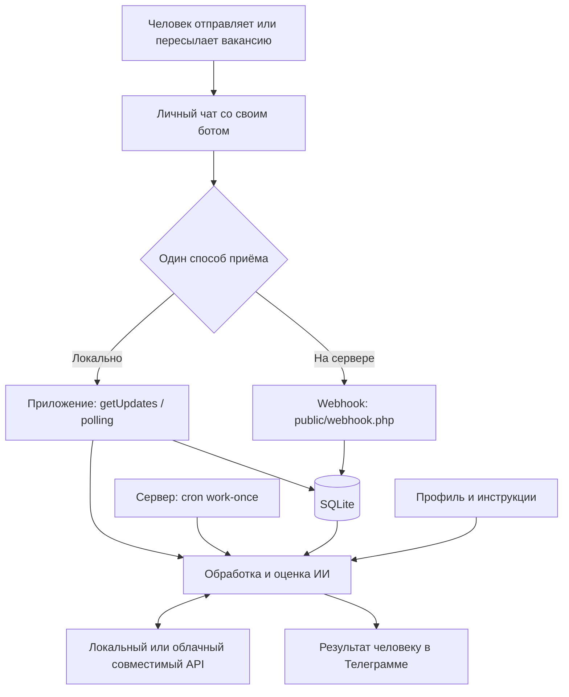

# Telegram Vacancy Monitor

Приложение для персонального отбора вакансий с помощью ИИ. Отправьте или перешлите текст своему боту в Телеграмме — он сохранит вакансию и пришлёт оценку с учётом вашего опыта, предпочтений и ограничений.

Подходит тем, кто собирает предложения из разных источников и хочет быстрее решать, на какие стоит откликаться. Критерии задаются в личном профиле и инструкциях; для анализа можно подключить локальную модель или облачный OpenAI-совместимый API.

## Возможности

- Приём текстов и пересланных публикаций в личном чате только от разрешённого пользователя.
- Сохранение в SQLite и защита от повторной обработки по доступным идентификаторам сообщений.
- Персональная оценка: «Откликаться», «Погранично» или «Пропустить», приоритет, совпадения, риски и вопросы.
- Сохранение результата перед отправкой и отдельные повторные попытки анализа и доставки.
- Локальное приложение с меню на русском и английском или работа на сервере без открытого окна терминала.

## Как это работает

Локально один процесс принимает сообщения и выполняет анализ. На сервере webhook только сохраняет входящие сообщения, а обработку запускает cron. Эти режимы используют один бот и [переключаются последовательно](docs/guides/vds-webhook.md#переключение-режимов).

## Способы запуска

### Локальное приложение

Форматы архивов предусмотрены для Linux x86_64, Windows x64 и macOS ARM64. В архив входят нативный исполняемый файл, PHP и Gum: устанавливать PHP, Composer или Gum отдельно не нужно. Выбирайте архив своей платформы на странице [Releases](https://github.com/yaleksandr89/telegram-vacancy-monitor/releases) и следуйте [руководству по локальному запуску](docs/guides/local-gum.md).

### Серверный режим

На VDS сообщения принимает PHP-FPM через HTTPS webhook, а cron запускает CLI-команду `work-once`. Нужны PHP `^8.5`, расширения из [Composer-конфигурации](composer.json) и закрытое от HTTP хранилище. Установка описана в [серверном руководстве](docs/guides/vds-webhook.md).

## Быстрый старт

Выберите **один** способ запуска и сначала подготовьте установку:

- **Локальное приложение:** выберите архив своей платформы на странице [Releases](https://github.com/yaleksandr89/telegram-vacancy-monitor/releases), распакуйте его по [руководству](docs/guides/local-gum.md) и откройте папку `telegram-vacancy-monitor/`.
- **Сервер:** установите проект из исходников и подготовьте PHP-FPM и HTTPS по [серверному руководству](docs/guides/vds-webhook.md). Дальнейшие действия выполняйте из корня установленного проекта.

В подготовленной папке приложения выполните общую настройку:

1. [Создайте бота](docs/guides/telegram-bot.md) через BotFather. Создайте `config/bot.ini` по [образцу](config/bot.example.ini) и укажите токен.
2. Отправьте боту `/start`, узнайте свой ID через приложение или `php bin/bot.php identify` в установке из исходников и запишите его в `TELEGRAM_ALLOWED_USER_ID`.
3. Подготовьте `config/profile/local/candidate.md` и `config/profile/local/instructions.md` по [руководству профиля](config/profile/README.md), затем [подключите модель](docs/guides/ai-models.md).

Запустите выбранный режим:

- **Локально:** оставьте `TELEGRAM_RECEIVE_MODE = "polling"`, запустите `./vacancy-monitor` в Linux/macOS или `.\vacancy-monitor.exe` в PowerShell. Выберите «Проверить готовность», затем «Запустить мониторинг».
- **На сервере:** выберите `TELEGRAM_RECEIVE_MODE = "webhook"`, задайте секрет, инициализируйте БД командой `php bin/bot.php work-once`, зарегистрируйте webhook и добавьте эту команду в cron по [серверному руководству](docs/guides/vds-webhook.md).

Отправьте боту текст вакансии. После сохранения придёт подтверждение, затем — результат оценки. Бот получает сообщения от вас; история произвольных каналов автоматически не читается.

## Примеры анализа

[Сценарий для Go-разработчика](docs/examples/vacancy-analysis.md#go-разработчик) показывает, как описать технический опыт и требования к работе. [Сценарий для аналитика](docs/examples/vacancy-analysis.md#аналитик) помогает отделить обязательные навыки от условий, которые нужно уточнить.

## Документация

**Запуск и настройка:** [локальное приложение](docs/guides/local-gum.md) · [сервер и webhook](docs/guides/vds-webhook.md) · [бот и доступ](docs/guides/telegram-bot.md) · [модели ИИ](docs/guides/ai-models.md) · [личный профиль](config/profile/README.md).

**Справочники и помощь:** [все параметры конфигурации](docs/reference/configuration.md) · [JSON и уведомления](docs/reference/analysis-result.md) · [примеры входных данных](docs/examples/vacancy-analysis.md) · [устранение неполадок](docs/guides/troubleshooting.md).

## Лицензия

Собственные материалы проекта распространяются под [MIT](LICENSE). Для сторонних компонентов действуют их собственные лицензии.

## Обратная связь

Об ошибках и предложениях сообщайте в [GitHub Issues](https://github.com/yaleksandr89/telegram-vacancy-monitor/issues). Для сообщений об уязвимостях используйте [политику безопасности](.github/SECURITY.md).
