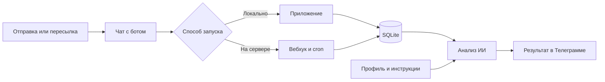

# Telegram Vacancy Monitor

## Выберите язык

| Русский | English | Español | 中文 | Français | Deutsch |
| --- | --- | --- | --- | --- | --- |
| **Выбран** | [English](docs/readme/README_en.md) | [Español](docs/readme/README_es.md) | [中文](docs/readme/README_zh.md) | [Français](docs/readme/README_fr.md) | [Deutsch](docs/readme/README_de.md) |

Приложение для персонального отбора вакансий с помощью ИИ. Отправьте или перешлите вакансию боту в Телеграмме. Приложение сохранит её и пришлёт оценку с учётом вашего опыта, предпочтений и ограничений.

Подходит тем, кто собирает предложения из разных источников и хочет быстрее решать, на какие стоит откликаться. Критерии задаются в профиле кандидата и инструкциях оценки. Примеры их оформления приведены в [руководстве](docs/examples/vacancy-analysis.md). Подключить можно локальную или облачную модель ИИ через интерфейс Chat Completions.

## Демонстрация

Локальное приложение на Windows · LM Studio · модель `qwen/qwen3.5-9b`.

https://github.com/user-attachments/assets/afdc1b8d-c4bb-49d4-b82f-67436f11f69c

## Возможности

- Приём вакансий через бота от пользователя, чей Telegram ID указан в настройках.
- Сохранение вакансий в SQLite и защита от повторной доставки. Повторную пересылку одной публикации приложение распознаёт, если Телеграмм передал идентификаторы источника. [Как работают сохранение, курсор и защита от повторов](docs/guides/message-processing.md).
- Персональная оценка: «Откликаться», «Погранично» или «Пропустить», приоритет, совпадения, риски и вопросы.
- Сохранение результата перед отправкой и отдельные повторные попытки анализа и доставки.
- Локальное приложение с меню на русском и английском языках или работа на сервере.

## Как это работает

В локальном режиме приложение принимает и анализирует вакансии. На сервере вебхук сохраняет сообщения, а cron запускает обработку. [Как переключаться между режимами](docs/guides/vds-webhook.md#переключение-режимов).

## Способы запуска и быстрый старт

**Локальное приложение.** Готовые архивы для Linux x86_64, Windows x64 и macOS ARM64 доступны на странице [Releases](https://github.com/yaleksandr89/telegram-vacancy-monitor/releases). [Инструкция по запуску](docs/guides/local-gum.md) описывает использование архива: PHP и компоненты входят в комплект, меню отображает Gum, в Windows запуском управляет PowerShell.

**Сервер.** Для запуска из исходников нужны PHP 8.5 (CLI и PHP-FPM), Composer, расширения `curl`, `json`, `mbstring`, `PDO`, `pdo_sqlite`, HTTPS и cron. Данные хранятся в SQLite, отдельный сервер базы данных не требуется. Установка и настройка описаны в [серверном руководстве](docs/guides/vds-webhook.md).

Затем настройте выбранную установку:

1. [Создайте бота](docs/guides/telegram-bot.md) и запишите токен бота, полученный от BotFather в `config/bot.ini` по [образцу](config/bot.example.ini).
2. Отправьте боту `/start`, [узнайте свой Telegram ID](docs/guides/telegram-bot.md#узнайте-свой-id) и сохраните его в `TELEGRAM_ALLOWED_USER_ID`.
3. Заполните [профиль и инструкции](config/profile/README.md), [подключите модель ИИ](docs/guides/ai-models.md).
4. Запустите мониторинг через меню приложения или включите серверный режим по выбранному руководству.

Отправьте боту текст вакансии или перешлите публикацию. Бот подтвердит сохранение и пришлёт результат оценки.

## Примеры анализа

- [Go-разработчик](docs/examples/go-developer.md) — профиль, правила оценки и техническая вакансия.
- [Продуктовый аналитик](docs/examples/analyst.md) — профиль, требования к аналитическим навыкам и текст вакансии.

## Документация

### Запуск и настройка

- [Локальное приложение](docs/guides/local-gum.md) — установка и запуск на Linux, Windows и macOS.
- [Интерфейс приложения](docs/guides/local-interface.md) — главное меню, справка и проверка настроек.
- [Серверный режим](docs/guides/vds-webhook.md) — настройка вебхука, PHP-FPM и cron.
- [Telegram-бот](docs/guides/telegram-bot.md) — создание бота, определение ID и отправка вакансий.
- [Модели ИИ](docs/guides/ai-models.md) — подключение локальной или облачной модели.
- [Профиль кандидата](config/profile/README.md) — оформление профиля и правил оценки.

### Обработка и справочники

- [Как обрабатываются вакансии](docs/guides/message-processing.md) — сохранение, курсор, повторы и восстановление обработки.
- [Параметры конфигурации](docs/reference/configuration.md) — настройки приложения с примерами.
- [Формат оценки](docs/reference/analysis-result.md) — JSON модели и уведомления в Телеграмме.
- [Примеры вакансий](docs/examples/vacancy-analysis.md) — техническая и аналитическая должности.
- [Устранение неполадок](docs/guides/troubleshooting.md) — диагностика и типичные ошибки.

## Обратная связь

- Сообщить об ошибке или предложить улучшение — [GitHub Issues](https://github.com/yaleksandr89/telegram-vacancy-monitor/issues).
- Обсудить использование приложения — [GitHub Discussions](https://github.com/yaleksandr89/telegram-vacancy-monitor/discussions).

---

  Если проект оказался полезен, поставьте звезду на GitHub — так его будет проще найти другим. 🤘

