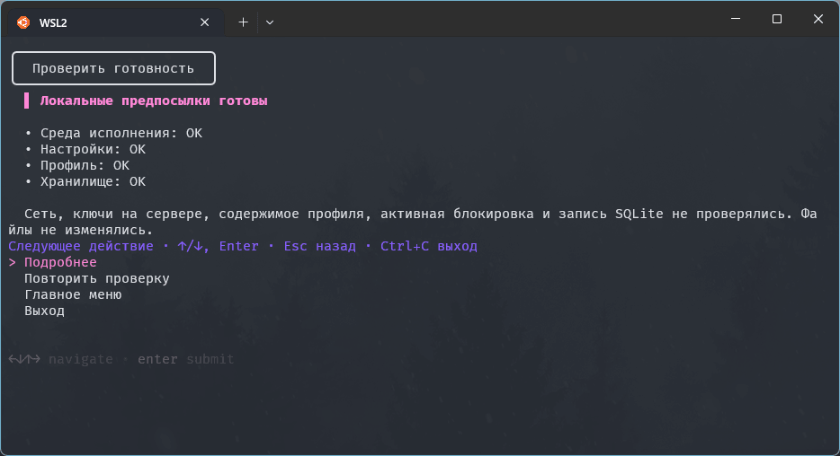

# Interface de l’application locale

## Choisir une langue

| Русский | English | Español | 中文 | Français | Deutsch |
| --- | --- | --- | --- | --- | --- |
| [Русский](local-interface.md) | [English](local-interface_en.md) | [Español](local-interface_es.md) | [中文](local-interface_zh.md) | **Sélectionné** | [Deutsch](local-interface_de.md) |

[← Retour au README](../readme/README_fr.md)

L’application utilise des menus Gum sous Linux, Windows et macOS. Sous Windows, PowerShell assure son lancement. Les captures ci-dessous montrent le menu en russe.

## Menu principal

Le menu permet de lancer la surveillance, vérifier la configuration, déterminer l’identifiant Telegram, consulter l’aide et changer de langue.

## Aide et démarrage rapide

## Vérification de la configuration

L’application indique quels paramètres doivent être renseignés avant le lancement de la surveillance.

L’installation et les actions du menu sont décrites dans le [guide de démarrage local](local-gum_fr.md).
