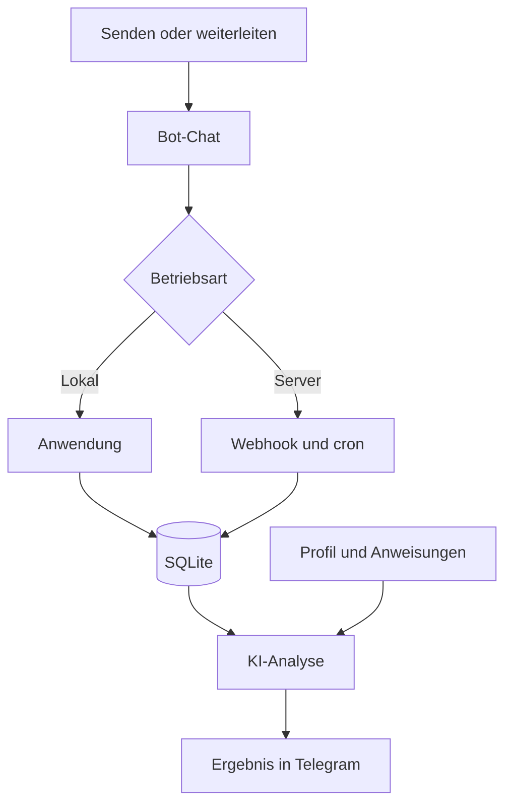

# Telegram Vacancy Monitor

## Sprache auswählen

| Русский | English | Español | 中文 | Français | Deutsch |
| --- | --- | --- | --- | --- | --- |
| [Русский](../../../README.md) | [English](../en/README.md) | [Español](../es/README.md) | [中文](../zh/README.md) | [Français](../fr/README.md) | **Ausgewählt** |

Eine Anwendung zur persönlichen KI-gestützten Bewertung von Stellenangeboten. Sende eine Stellenausschreibung an deinen Telegram-Bot oder leite sie an ihn weiter. Die Anwendung speichert sie und schickt dir eine Bewertung, die deine Erfahrung, Vorlieben und Einschränkungen berücksichtigt.

Sie richtet sich an Menschen, die Stellenangebote aus verschiedenen Quellen sammeln und schneller entscheiden möchten, auf welche sich eine Bewerbung lohnt. Die Kriterien werden im Kandidatenprofil und in den Bewertungsanweisungen festgelegt. Der [Beispielleitfaden](vacancy-analysis.md) zeigt, wie diese erstellt werden. Über die Chat-Completions-Schnittstelle lässt sich ein lokales oder cloudbasiertes KI-Modell anbinden.

## Demonstration

Lokale Anwendung unter Windows · LM Studio · Modell `qwen/qwen3.5-9b`.

https://github.com/user-attachments/assets/afdc1b8d-c4bb-49d4-b82f-67436f11f69c

## Funktionen

- Stellenangebote über den Bot von dem Benutzer empfangen, dessen Telegram-ID in der Konfiguration hinterlegt ist.
- Stellenangebote in SQLite speichern und wiederholte Zustellungen abfangen. Die Anwendung erkennt auch das erneute Weiterleiten derselben Veröffentlichung, sofern Telegram die Quellkennungen übermittelt. [Speicherung, Cursor und Duplikaterkennung](message-processing.md).
- Persönliche Bewertung: „Bewerben“, „Grenzfall“ oder „Überspringen“, einschließlich Priorität, Übereinstimmungen, Risiken und offener Fragen.
- Die Bewertung vor dem Versand speichern; Analyse und Zustellung werden unabhängig voneinander erneut versucht.
- Die lokale Anwendung mit russisch- und englischsprachigen Menüs verwenden oder den Serverbetrieb nutzen.

## Funktionsweise

Im lokalen Betrieb empfängt und analysiert die Anwendung Stellenangebote. Auf dem Server speichert der Webhook Nachrichten; cron startet deren Verarbeitung. [Zwischen den Betriebsarten wechseln](vds-webhook.md#modi-wechseln).

## Betriebsarten und Schnellstart

**Lokale Anwendung.** Die Standalone-Archive für Linux x86_64, Windows x64 und macOS ARM64 stehen auf der Seite [Releases](https://github.com/yaleksandr89/telegram-vacancy-monitor/releases) bereit. Die [Startanleitung](local-gum.md) erklärt, wie du das Archiv verwendest: PHP und seine Komponenten sind enthalten, Gum zeigt das Menü an und unter Windows steuert PowerShell den Start.

**Server.** Für die Ausführung aus dem Quellcode werden PHP 8.5 (CLI und PHP-FPM), Composer, die Erweiterungen `curl`, `json`, `mbstring`, `PDO` und `pdo_sqlite`, HTTPS und cron benötigt. Die Daten liegen in SQLite; ein separater Datenbankserver ist nicht erforderlich. Einrichtung und Konfiguration beschreibt die [Serveranleitung](vds-webhook.md).

Konfiguriere anschließend die gewählte Installation:

1. [Erstelle einen Bot](telegram-bot.md) und speichere das von BotFather erhaltene Token gemäß der [Vorlage](../../../config/bot.example.ini) in `config/bot.ini`.
2. Sende `/start` an den Bot, [ermittle deine Telegram-ID](telegram-bot.md#eigene-id-ermitteln) und trage sie in `TELEGRAM_ALLOWED_USER_ID` ein.
3. Erstelle dein [Profil und die Anweisungen](profile.md) und [verbinde ein KI-Modell](ai-models.md).
4. Starte die Überwachung über das Anwendungsmenü oder aktiviere den Serverbetrieb anhand der entsprechenden Anleitung.

Sende einen Ausschreibungstext an den Bot oder leite eine Veröffentlichung weiter. Der Bot bestätigt die Speicherung und schickt anschließend das Bewertungsergebnis.

## Analysebeispiele

- [Go-Entwickler](go-developer.md): Kandidatenprofil, Bewertungsregeln und eine technische Stellenausschreibung.
- [Produktanalyst](analyst.md): Kandidatenprofil, Anforderungen an analytische Fähigkeiten und Ausschreibungstext.

## Dokumentation

### Start und Konfiguration

- [Lokale Anwendung](local-gum.md): Installation und Start unter Linux, Windows und macOS.
- [Anwendungsoberfläche](local-interface.md): Hauptmenü, Hilfe und Konfigurationsprüfung.
- [Serverbetrieb](vds-webhook.md): Einrichtung von Webhook, PHP-FPM und cron.
- [Telegram-Bot](telegram-bot.md): Bot erstellen, ID ermitteln und Stellenangebote einreichen.
- [KI-Modelle](ai-models.md): ein lokales oder cloudbasiertes Modell anbinden.
- [Kandidatenprofil](profile.md): Profil und Bewertungsanweisungen erstellen.

### Verarbeitung und Referenzen

- [Verarbeitung von Stellenangeboten](message-processing.md): Speicherung, Cursor, Duplikate und Wiederaufnahme der Verarbeitung.
- [Konfigurationsreferenz](configuration.md): Anwendungseinstellungen mit Beispielen.
- [Bewertungsformat](analysis-result.md): Modell-JSON und Telegram-Benachrichtigungen.
- [Stellenbeispiele](vacancy-analysis.md): technische und analytische Positionen.
- [Fehlerbehebung](troubleshooting.md): Diagnose und häufige Fehler.

## Feedback

- Melde Fehler oder schlage Verbesserungen über [GitHub Issues](https://github.com/yaleksandr89/telegram-vacancy-monitor/issues) vor.
- Tausche dich über die Nutzung der Anwendung in [GitHub Discussions](https://github.com/yaleksandr89/telegram-vacancy-monitor/discussions) aus.

---

  Wenn dir das Projekt geholfen hat, gib ihm einen Stern auf GitHub, damit andere es leichter finden. 🤘

