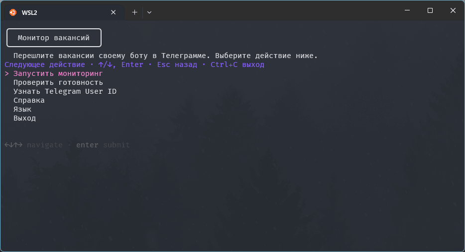
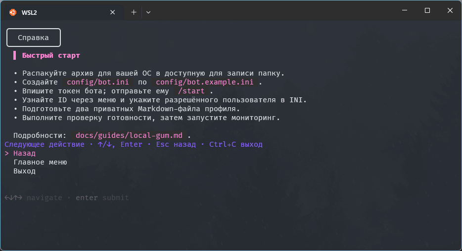

# Oberfläche der lokalen Anwendung

## Sprache auswählen

| Русский | English | Español | 中文 | Français | Deutsch |
| --- | --- | --- | --- | --- | --- |
| [Русский](../ru/local-interface.md) | [English](../en/local-interface.md) | [Español](../es/local-interface.md) | [中文](../zh/local-interface.md) | [Français](../fr/local-interface.md) | **Ausgewählt** |

[← Zurück zum README](README.md)

Die Anwendung verwendet unter Linux, Windows und macOS Gum-Menüs. Unter Windows wird sie über PowerShell gestartet. Die folgenden Screenshots zeigen das russischsprachige Menü.

## Hauptmenü

Im Menü lassen sich Überwachung, Bereitschaftsprüfung, Ermittlung der Telegram-ID, Hilfe und Sprachwechsel aufrufen.

## Hilfe und Schnellstart

## Konfigurationsprüfung

Die Anwendung zeigt, welche Einstellungen vor dem Start der Überwachung noch fehlen.

Installation und Menübedienung beschreibt die [Anleitung für den lokalen Start](local-gum.md).
