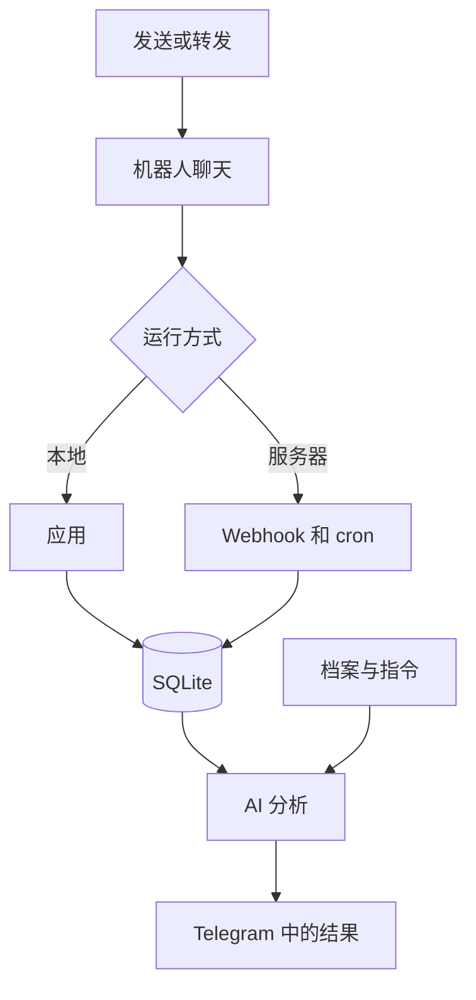

# Telegram Vacancy Monitor

## 选择语言

| Русский | English | Español | 中文 | Français | Deutsch |
| --- | --- | --- | --- | --- | --- |
| [Русский](../../../README.md) | [English](../en/README.md) | [Español](../es/README.md) | **已选择** | [Français](../fr/README.md) | [Deutsch](../de/README.md) |

这是一款利用 AI 对招聘职位进行个人化筛选的应用。将职位信息发送或转发给你的 Telegram 机器人，应用会保存信息，并根据你的经验、偏好和限制条件发送评估结果。

它适合从多个来源收集职位信息、希望更快判断哪些职位值得申请的人。筛选标准由候选人档案和评估指令定义。[示例指南](vacancy-analysis.md)介绍如何编写这些内容。你可以通过 Chat Completions 接口连接本地或云端 AI 模型。

## 演示

Windows 上运行的本地应用 · LM Studio · `qwen/qwen3.5-9b` 模型。

https://github.com/user-attachments/assets/afdc1b8d-c4bb-49d4-b82f-67436f11f69c

## 功能

- 通过机器人接收配置中指定 Telegram ID 的用户发送的职位信息。
- 使用 SQLite 保存职位，防止重复投递造成重复处理。如果 Telegram 提供了来源标识符，应用还能识别同一条发布内容的再次转发。[存储、游标与去重机制](message-processing.md)。
- 个性化评估：`apply`（建议申请）、`borderline`（待进一步确认）或 `skip`（跳过），并给出优先级、匹配点、风险及待确认的问题。
- 在发送前保存评估结果；分析和消息投递分别进行重试。
- 可以使用提供俄语和英语菜单的本地应用，也可以部署在服务器上运行。

## 工作原理

在本地模式下，应用接收并分析职位。服务器模式下，Webhook 保存消息，由 cron 触发后续处理。[了解如何切换模式](vds-webhook.md#切换模式)。

## 运行方式与快速入门

**本地应用。** 适用于 Linux x86_64、Windows x64 和 macOS ARM64 的 standalone 安装包已在 [Releases](https://github.com/yaleksandr89/telegram-vacancy-monitor/releases) 页面提供下载。[启动指南](local-gum.md)介绍如何使用安装包：其中已包含 PHP 及相关组件，Gum 负责显示菜单，Windows 上通过 PowerShell 管理启动。

**服务器。** 从源码运行需要 PHP 8.5（CLI 和 PHP-FPM）、Composer、`curl`、`json`、`mbstring`、`PDO`、`pdo_sqlite` 扩展、HTTPS 以及 cron。数据保存在 SQLite 中，无需独立数据库服务器。安装和配置步骤见[服务器指南](vds-webhook.md)。

接下来配置所选择的安装方式：

1. [创建机器人](telegram-bot.md)，按照[配置示例](../../../config/bot.example.ini)将 BotFather 提供的令牌保存到 `config/bot.ini`。
2. 向机器人发送 `/start`，[确认自己的 Telegram ID](telegram-bot.md#确认你的-id)，将其写入 `TELEGRAM_ALLOWED_USER_ID`。
3. 填写[候选人档案与评估指令](profile.md)，并[连接 AI 模型](ai-models.md)。
4. 从本地应用菜单开始监控，或按照所选指南启用服务器模式。

向机器人发送职位文本或转发一条招聘信息。机器人会确认已保存职位，并随后发送评估结果。

## 分析示例

- [Go 开发者](go-developer.md)：候选人档案、评估规则和技术职位。
- [产品分析师](analyst.md)：候选人档案、分析技能要求与职位文本。

## 文档

### 启动与配置

- [本地应用](local-gum.md)：在 Linux、Windows 和 macOS 上安装和启动。
- [应用界面](local-interface.md)：主菜单、帮助和配置检查。
- [服务器模式](vds-webhook.md)：Webhook、PHP-FPM 和 cron 的设置。
- [Telegram 机器人](telegram-bot.md)：创建机器人、确认 ID 和发送职位信息。
- [AI 模型](ai-models.md)：连接本地或云端模型。
- [候选人档案](profile.md)：编写档案和评估指令。

### 处理流程与参考资料

- [职位处理流程](message-processing.md)：保存、游标、去重与处理恢复。
- [配置参考](configuration.md)：带示例的应用配置说明。
- [评估结果格式](analysis-result.md)：模型返回的 JSON 和 Telegram 通知。
- [职位示例](vacancy-analysis.md)：技术和分析类岗位。
- [故障排查](troubleshooting.md)：诊断和常见错误。

## 反馈

- 通过 [GitHub Issues](https://github.com/yaleksandr89/telegram-vacancy-monitor/issues) 报告问题或提出改进建议。
- 在 [GitHub Discussions](https://github.com/yaleksandr89/telegram-vacancy-monitor/discussions) 讨论应用的使用。

---

  如果这个项目对你有帮助，欢迎在 GitHub 上点个 Star，让更多人能够找到它。🤘

