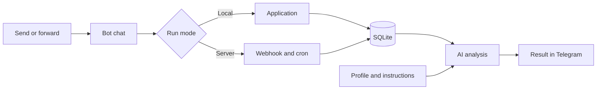

# Telegram Vacancy Monitor

## Choose a language

| Русский | English | Español | 中文 | Français | Deutsch |
| --- | --- | --- | --- | --- | --- |
| [Русский](../../README.md) | **Selected** | [Español](README_es.md) | [中文](README_zh.md) | [Français](README_fr.md) | [Deutsch](README_de.md) |

An application for personal AI-assisted vacancy screening. Send or forward a vacancy to your Telegram bot. The application saves it and sends an assessment based on your experience, preferences, and constraints.

It is intended for people who collect job offers from different sources and want to decide more quickly which ones are worth applying to. You define the criteria in your candidate profile and evaluation instructions. The [examples guide](../examples/vacancy-analysis_en.md) shows how to write them. You can connect a local or cloud AI model through the Chat Completions interface.

## Demonstration

Local application on Windows · LM Studio · `qwen/qwen3.5-9b` model.

https://github.com/user-attachments/assets/afdc1b8d-c4bb-49d4-b82f-67436f11f69c

## Features

- Receive vacancies through the bot from the user whose Telegram ID is configured.
- Save vacancies in SQLite and protect against repeated delivery. The application can recognize a second forward of the same publication if Telegram supplies source identifiers. [How storage, the cursor, and deduplication work](../guides/message-processing_en.md).
- Personalized assessment: “Apply”, “Borderline”, or “Skip”, including priority, matches, risks, and questions.
- Save the assessment before sending it, with separate retry attempts for analysis and delivery.
- Run the local application with menus in Russian and English, or run on a server.

## How it works

In local mode, the application receives and analyzes vacancies. On the server, the webhook saves messages and cron triggers processing. [How to switch between modes](../guides/vds-webhook_en.md#switching-modes).

## Ways to run and quick start

**Local application.** Standalone archives for Linux x86_64, Windows x64, and macOS ARM64 are available on the [Releases](https://github.com/yaleksandr89/telegram-vacancy-monitor/releases) page. The [launch guide](../guides/local-gum_en.md) explains how to use an archive: PHP and its components are bundled, Gum displays the menu, and PowerShell manages startup on Windows.

**Server.** Running from source requires PHP 8.5 (CLI and PHP-FPM), Composer, the `curl`, `json`, `mbstring`, `PDO`, and `pdo_sqlite` extensions, HTTPS, and cron. Data is stored in SQLite; no separate database server is required. Installation and configuration are covered by the [server guide](../guides/vds-webhook_en.md).

Then configure your chosen installation:

1. [Create a bot](../guides/telegram-bot_en.md) and save the token provided by BotFather in `config/bot.ini`, following the [example](../../config/bot.example.ini).
2. Send `/start` to the bot, [find your Telegram ID](../guides/telegram-bot_en.md#find-your-id), and set `TELEGRAM_ALLOWED_USER_ID` to that value.
3. Complete your [profile and instructions](../../config/profile/README_en.md), then [connect an AI model](../guides/ai-models_en.md).
4. Start monitoring through the application menu or enable server mode according to the selected guide.

Send vacancy text to the bot or forward a publication. The bot confirms that it has saved the vacancy and sends the assessment result.

## Analysis examples

- [Go developer](../examples/go-developer_en.md): candidate profile, evaluation rules, and a technical vacancy.
- [Product analyst](../examples/analyst_en.md): candidate profile, analytical-skills requirements, and vacancy text.

## Documentation

### Launch and configuration

- [Local application](../guides/local-gum_en.md): installation and startup on Linux, Windows, and macOS.
- [Application interface](../guides/local-interface_en.md): main menu, help, and configuration checks.
- [Server mode](../guides/vds-webhook_en.md): webhook, PHP-FPM, and cron setup.
- [Telegram bot](../guides/telegram-bot_en.md): creating a bot, determining your ID, and submitting vacancies.
- [AI models](../guides/ai-models_en.md): connecting a local or cloud model.
- [Candidate profile](../../config/profile/README_en.md): preparing your profile and evaluation instructions.

### Processing and references

- [Vacancy processing](../guides/message-processing_en.md): persistence, cursor, duplicates, and processing recovery.
- [Configuration reference](../reference/configuration_en.md): application settings with examples.
- [Assessment format](../reference/analysis-result_en.md): model JSON and Telegram notifications.
- [Vacancy examples](../examples/vacancy-analysis_en.md): technical and analytical roles.
- [Troubleshooting](../guides/troubleshooting_en.md): diagnostics and common errors.

## Feedback

- Report a bug or suggest an improvement through [GitHub Issues](https://github.com/yaleksandr89/telegram-vacancy-monitor/issues).
- Discuss using the application in [GitHub Discussions](https://github.com/yaleksandr89/telegram-vacancy-monitor/discussions).

---

  If the project was useful, give it a star on GitHub so others can find it more easily. 🤘

