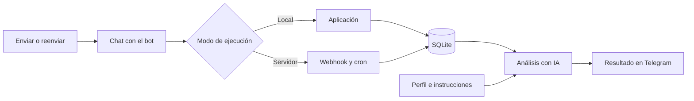

# Telegram Vacancy Monitor

## Elige un idioma

| Русский | English | Español | 中文 | Français | Deutsch |
| --- | --- | --- | --- | --- | --- |
| [Русский](../../README.md) | [English](README_en.md) | **Seleccionado** | [中文](README_zh.md) | [Français](README_fr.md) | [Deutsch](README_de.md) |

Aplicación para evaluar personalmente ofertas de empleo con ayuda de IA. Envía o reenvía una oferta a tu bot de Telegram. La aplicación la guarda y te envía una evaluación basada en tu experiencia, preferencias y limitaciones.

Está pensada para quienes reúnen ofertas de distintas fuentes y quieren decidir más rápido a cuáles merece la pena postularse. Los criterios se definen en el perfil del candidato y en las instrucciones de evaluación. La [guía de ejemplos](../examples/vacancy-analysis_es.md) muestra cómo redactarlos. Puedes conectar un modelo de IA local o en la nube mediante la interfaz Chat Completions.

## Demostración

Aplicación local en Windows · LM Studio · modelo `qwen/qwen3.5-9b`.

https://github.com/user-attachments/assets/afdc1b8d-c4bb-49d4-b82f-67436f11f69c

## Funciones

- Recibir ofertas mediante el bot del usuario cuyo Telegram ID figura en la configuración.
- Guardar ofertas en SQLite y evitar duplicados por entregas repetidas. La aplicación puede reconocer un segundo reenvío de la misma publicación si Telegram proporciona identificadores de origen. [Cómo funcionan el almacenamiento, el cursor y la deduplicación](../guides/message-processing_es.md).
- Evaluación personalizada: «Postularse», «Dudoso» u «Omitir», con prioridad, coincidencias, riesgos y preguntas.
- Guardar la evaluación antes de enviarla y realizar reintentos independientes para el análisis y la entrega.
- Usar la aplicación local, cuyo menú está disponible en ruso e inglés, o ejecutarla en un servidor.

## Cómo funciona

En modo local, la aplicación recibe y analiza ofertas. En el servidor, el webhook guarda los mensajes y cron inicia su procesamiento. [Cómo cambiar entre modos](../guides/vds-webhook_es.md#cambio-de-modo).

## Formas de ejecución e inicio rápido

**Aplicación local.** Tras su publicación, los archivos verificados para Linux x86_64, Windows x64 y macOS ARM64 aparecerán en [Releases](https://github.com/yaleksandr89/telegram-vacancy-monitor/releases). Hasta que se publique la primera versión, no hay ningún archivo listo para descargar allí. La [guía de ejecución](../guides/local-gum_es.md) explica cómo usar un archivo publicado: PHP y sus componentes están incluidos, Gum muestra el menú y PowerShell controla el inicio en Windows.

**Servidor.** La ejecución desde el código fuente requiere PHP 8.5 (CLI y PHP-FPM), Composer, las extensiones `curl`, `json`, `mbstring`, `PDO` y `pdo_sqlite`, HTTPS y cron. Los datos se almacenan en SQLite; no hace falta un servidor de base de datos independiente. La instalación y configuración se describen en la [guía del servidor](../guides/vds-webhook_es.md).

Después, configura la instalación elegida:

1. [Crea un bot](../guides/telegram-bot_es.md) y guarda en `config/bot.ini` el token que proporciona BotFather siguiendo el [ejemplo](../../config/bot.example.ini).
2. Envía `/start` al bot, [averigua tu Telegram ID](../guides/telegram-bot_es.md#averigua-tu-id) y guárdalo en `TELEGRAM_ALLOWED_USER_ID`.
3. Prepara el [perfil y las instrucciones](../../config/profile/README_es.md) y [conecta un modelo de IA](../guides/ai-models_es.md).
4. Inicia el seguimiento desde el menú de la aplicación o activa el modo servidor según la guía correspondiente.

Envía al bot el texto de una oferta o reenvía una publicación. El bot confirma que la ha guardado y te envía el resultado de la evaluación.

## Ejemplos de análisis

- [Desarrollador Go](../examples/go-developer_es.md): perfil, reglas de evaluación y oferta técnica.
- [Analista de producto](../examples/analyst_es.md): perfil, requisitos de análisis y texto de una oferta.

## Documentación

### Ejecución y configuración

- [Aplicación local](../guides/local-gum_es.md): instalación e inicio en Linux, Windows y macOS.
- [Interfaz de la aplicación](../guides/local-interface_es.md): menú principal, ayuda y comprobación de configuración.
- [Modo servidor](../guides/vds-webhook_es.md): configuración de webhook, PHP-FPM y cron.
- [Bot de Telegram](../guides/telegram-bot_es.md): creación del bot, identificación del ID y envío de ofertas.
- [Modelos de IA](../guides/ai-models_es.md): conexión de un modelo local o en la nube.
- [Perfil del candidato](../../config/profile/README_es.md): preparación del perfil y las reglas de evaluación.

### Procesamiento y referencias

- [Procesamiento de ofertas](../guides/message-processing_es.md): almacenamiento, cursor, duplicados y recuperación del procesamiento.
- [Referencia de configuración](../reference/configuration_es.md): ajustes de la aplicación con ejemplos.
- [Formato de evaluación](../reference/analysis-result_es.md): JSON del modelo y notificaciones de Telegram.
- [Ejemplos de ofertas](../examples/vacancy-analysis_es.md): puestos técnicos y de análisis.
- [Solución de problemas](../guides/troubleshooting_es.md): diagnósticos y errores habituales.

## Comentarios y sugerencias

- Informa de un error o sugiere una mejora en [GitHub Issues](https://github.com/yaleksandr89/telegram-vacancy-monitor/issues).
- Habla sobre el uso de la aplicación en [GitHub Discussions](https://github.com/yaleksandr89/telegram-vacancy-monitor/discussions).

---

  Si el proyecto te ha resultado útil, dale una estrella en GitHub para ayudar a que más personas lo encuentren. 🤘

