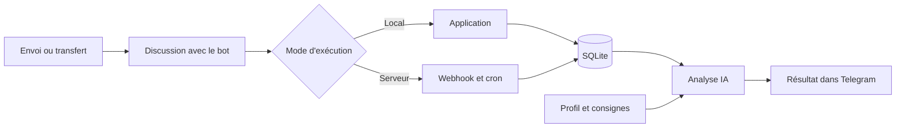

# Telegram Vacancy Monitor

## Choisir une langue

| Русский | English | Español | 中文 | Français | Deutsch |
| --- | --- | --- | --- | --- | --- |
| [Русский](../../README.md) | [English](README_en.md) | [Español](README_es.md) | [中文](README_zh.md) | **Sélectionné** | [Deutsch](README_de.md) |

Une application pour sélectionner personnellement des offres d'emploi à l'aide de l'IA. Envoyez ou transférez une offre à votre bot Telegram. L'application l'enregistre et vous transmet une évaluation tenant compte de votre expérience, de vos préférences et de vos contraintes.

Elle s'adresse aux personnes qui rassemblent des offres de plusieurs sources et souhaitent déterminer plus rapidement celles auxquelles postuler. Les critères sont définis dans le profil du candidat et les consignes d'évaluation. Le [guide des exemples](../examples/vacancy-analysis_fr.md) montre comment les rédiger. Vous pouvez connecter un modèle d'IA local ou hébergé via l'interface Chat Completions.

## Démonstration

Application locale sous Windows · LM Studio · modèle `qwen/qwen3.5-9b`.

https://github.com/user-attachments/assets/afdc1b8d-c4bb-49d4-b82f-67436f11f69c

## Fonctionnalités

- Réception des offres par le bot de l'utilisateur dont l'identifiant Telegram est indiqué dans la configuration.
- Enregistrement des offres dans SQLite et protection contre les livraisons répétées. L'application reconnaît un nouveau transfert d'une même publication si Telegram fournit les identifiants de sa source. [Fonctionnement du stockage, du curseur et de la déduplication](../guides/message-processing_fr.md).
- Évaluation personnalisée : « Postuler », « À confirmer » ou « Ignorer », avec priorité, correspondances, risques et questions.
- Enregistrement de l'évaluation avant l'envoi, avec des tentatives supplémentaires distinctes pour l'analyse et la livraison.
- Application locale dotée de menus en russe et en anglais, ou fonctionnement sur un serveur.

## Fonctionnement

En mode local, l'application reçoit et analyse les offres. Sur le serveur, le webhook enregistre les messages et cron lance leur traitement. [Comment passer d'un mode à l'autre](../guides/vds-webhook_fr.md#changer-de-mode).

## Modes d'exécution et démarrage rapide

**Application locale.** Les archives standalone pour Linux x86_64, Windows x64 et macOS ARM64 sont disponibles sur la page [Releases](https://github.com/yaleksandr89/telegram-vacancy-monitor/releases). Le [guide de démarrage](../guides/local-gum_fr.md) explique comment utiliser une archive : PHP et ses composants sont inclus, Gum affiche le menu et PowerShell gère le lancement sous Windows.

**Serveur.** L'exécution depuis les sources exige PHP 8.5 (CLI et PHP-FPM), Composer, les extensions `curl`, `json`, `mbstring`, `PDO` et `pdo_sqlite`, HTTPS et cron. Les données sont conservées dans SQLite ; aucun serveur de base de données séparé n'est nécessaire. L'installation et la configuration sont décrites dans le [guide serveur](../guides/vds-webhook_fr.md).

Configurez ensuite l'installation choisie :

1. [Créez un bot](../guides/telegram-bot_fr.md) et inscrivez le jeton fourni par BotFather dans `config/bot.ini`, en suivant l'[exemple](../../config/bot.example.ini).
2. Envoyez `/start` au bot, [déterminez votre identifiant Telegram](../guides/telegram-bot_fr.md#trouver-votre-identifiant), puis enregistrez-le dans `TELEGRAM_ALLOWED_USER_ID`.
3. Rédigez votre [profil et vos consignes](../../config/profile/README_fr.md), puis [connectez un modèle d'IA](../guides/ai-models_fr.md).
4. Lancez la surveillance depuis le menu de l'application ou activez le mode serveur selon le guide choisi.

Envoyez au bot le texte d'une offre ou transférez-lui une publication. Le bot confirme son enregistrement puis vous transmet le résultat de l'évaluation.

## Exemples d'analyse

- [Développeur Go](../examples/go-developer_fr.md) : profil, règles d'évaluation et offre technique.
- [Analyste produit](../examples/analyst_fr.md) : profil, compétences analytiques demandées et texte de l'offre.

## Documentation

### Démarrage et configuration

- [Application locale](../guides/local-gum_fr.md) : installation et démarrage sous Linux, Windows et macOS.
- [Interface de l'application](../guides/local-interface_fr.md) : menu principal, aide et vérification des paramètres.
- [Mode serveur](../guides/vds-webhook_fr.md) : configuration du webhook, de PHP-FPM et de cron.
- [Bot Telegram](../guides/telegram-bot_fr.md) : création, identification de l'utilisateur et envoi des offres.
- [Modèles d'IA](../guides/ai-models_fr.md) : connexion d'un modèle local ou hébergé.
- [Profil du candidat](../../config/profile/README_fr.md) : préparation du profil et des consignes d'évaluation.

### Traitement et références

- [Traitement des offres](../guides/message-processing_fr.md) : stockage, curseur, doublons et reprise du traitement.
- [Référence de configuration](../reference/configuration_fr.md) : paramètres de l'application et exemples.
- [Format de l'évaluation](../reference/analysis-result_fr.md) : JSON du modèle et notifications Telegram.
- [Exemples d'offres](../examples/vacancy-analysis_fr.md) : postes techniques et analytiques.
- [Dépannage](../guides/troubleshooting_fr.md) : diagnostic et erreurs courantes.

## Retours et suggestions

- Signalez un problème ou proposez une amélioration dans les [GitHub Issues](https://github.com/yaleksandr89/telegram-vacancy-monitor/issues).
- Discutez de l'utilisation de l'application dans les [GitHub Discussions](https://github.com/yaleksandr89/telegram-vacancy-monitor/discussions).

---

  Si ce projet vous a été utile, attribuez-lui une étoile sur GitHub pour aider d'autres personnes à le découvrir. 🤘

